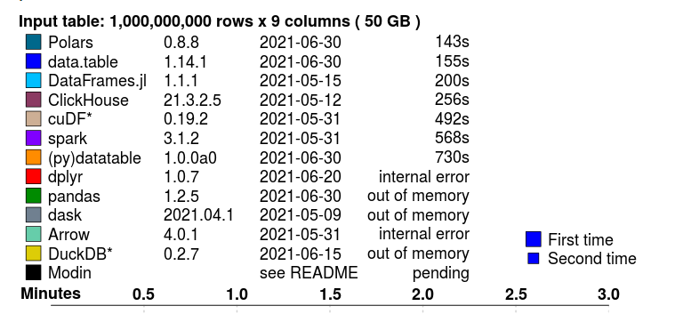

# rust

### 现成列表

1. [https://course.rs/](https://course.rs/)
2. [https://doc.rust-lang.org/stable/rust-by-example](https://doc.rust-lang.org/stable/rust-by-example)
3. [https://kaisery.github.io/trpl-zh-cn/](https://kaisery.github.io/trpl-zh-cn/)
4. [https://github.com/anshulrgoyal/rust-web-developer-roadmap/blob/master/i18n/zh-CN/README-zh-CN.md](https://github.com/anshulrgoyal/rust-web-developer-roadmap/blob/master/i18n/zh-CN/README-zh-CN.md)
5. [https://github.com/mre/idiomatic-rust](https://github.com/mre/idiomatic-rust)
6. [https://rustmagazine.github.io/rust_magazine_2021](https://rustmagazine.github.io/rust_magazine_2021)
7. [RustMagazine 中文月刊https://rustmagazine.github.io/rust_magazine_2021](https://rustmagazine.github.io/rust_magazine_2021)
8. [https://github.com/rust-unofficial/awesome-rust](https://github.com/rust-unofficial/awesome-rust)
9. [rust 语法列表 https://cheats.rs/](https://cheats.rs/)
10. [https://github.com/wubx/rust-in-databend](https://github.com/wubx/rust-in-databend)
11. [https://github.com/suhanyujie/resourses](https://github.com/suhanyujie/resourses)
12. [https://hub.fastgit.xyz/sunface/rust-course](https://hub.fastgit.xyz/sunface/rust-course)
13. [https://era.co/blog/unbuffered-io-slows-rust-programs](https://era.co/blog/unbuffered-io-slows-rust-programs)
14. [https://renato.athaydes.com/posts/how-to-write-fast-rust-code.html](https://renato.athaydes.com/posts/how-to-write-fast-rust-code.html)
15. [https://tiemoko.com/slides/SafeAndPortableDataStructureDesign_CodeAndSupply_Dec2021.pdf](https://tiemoko.com/slides/SafeAndPortableDataStructureDesign_CodeAndSupply_Dec2021.pdf)
16. [https://blog.adamchalmers.com/nom-chars/](https://blog.adamchalmers.com/nom-chars/)
17. [https://federicoterzi.com/blog/12-rust-tips-and-tricks-you-might-not-know-yet](https://federicoterzi.com/blog/12-rust-tips-and-tricks-you-might-not-know-yet)
18. [https://dev.to/sbelzile/making-games-in-rust-part-6-generating-a-map-4aic](https://dev.to/sbelzile/making-games-in-rust-part-6-generating-a-map-4aic)
19. [https://pkolaczk.github.io/server-slower-than-a-laptop/](https://pkolaczk.github.io/server-slower-than-a-laptop/)
20. [硬件rust教程 https://lupyuen.github.io/articles/rusti2c](https://lupyuen.github.io/articles/rusti2c)
21. [Easy to use RDMA API in Rust async https://github.com/datenlord/async-rdma](https://github.com/datenlord/async-rdma)
22. [https://github.com/CleanCut/ultimate_rust_crash_course](https://github.com/CleanCut/ultimate_rust_crash_course)
23. 

### 最佳实践
- orm
1. [orm 目前最好使用，sea-orm，它是基于 sqlx 实现的 ORM 框架，号称要实现 Rust 版本 的 ActiveRecord Ruby on Rails ](https://github.com/SeaQL/sea-orm)
2. [国内 Rust 社区小伙伴 @zhuxiujia 也实现了一个异步 ORM 框架 rbatis。Rbatis 并不是基于 sqlx 实现的，它的灵感来自于 Java 的 ORM 框架 Mybatis。Rbatis 提供了一些内置插件，可以针对一些常用场景增加开发效率。](https://github.com/rbatis/rbatis)
3. [https://github.com/ddddddO/qoo](https://github.com/ddddddO/qoo)
- web 
3. [A full-featured and easy-to-use web framework with the Rust programming language.](https://github.com/poem-web/poem)
4. [https://github.com/actix/actix-web](https://github.com/actix/actix-web)
5. [go-zero 实战 https://github.com/zhoushuguang/lebron](https://github.com/zhoushuguang/lebron)
6. [https://marabos.nl/atomics/](https://marabos.nl/atomics/)

### cheatsheet 备忘录 面试

1. [https://flakm.github.io/posts/rust_interview_questions/](https://flakm.github.io/posts/rust_interview_questions/)
2. 

### 浏览器扩展工具
1. [显示cargo.toml 中依赖相关信息 https://chrome.google.com/webstore/detail/createhub/ipcffemefdnmgnhkpdkenddfoebpejei](https://chrome.google.com/webstore/detail/createhub/ipcffemefdnmgnhkpdkenddfoebpejei)

### 教程/文章/小抄/规范/记事

1. [https://tourofrust.com/00_zh-cn.html](https://tourofrust.com/00_zh-cn.html)
2. [https://github.com/rust-lang/rustlings](https://github.com/rust-lang/rustlings)
3. [https://github.com/dslchd/tokio-cn-doc](https://github.com/dslchd/tokio-cn-doc)
4. [https://github.com/tony612/tokio-internals](https://github.com/tony612/tokio-internals)
5. [https://github.com/mini-lust/tutorials https://github.com/mini-lust/tutorials](https://github.com/mini-lust/tutorials)
6. [https://github.com/jack1232/wgpu-step-by-step](https://github.com/jack1232/wgpu-step-by-step)
7. [强类型化的诅咒 https://fasterthanli.me/articles/the-curse-of-strong-typing](https://fasterthanli.me/articles/the-curse-of-strong-typing)
8. [https://flakm.github.io/posts/heap_allocation/](https://flakm.github.io/posts/heap_allocation/)
9. [https://conradludgate.com/posts/macros_match](https://conradludgate.com/posts/macros_match)
10. 

### web 框架

1. A web framework for Rust
   [https://github.com/SergioBenitez/Rocket](https://github.com/SergioBenitez/Rocket)
2. Actix web is a small, pragmatic, and extremely fast rust web framework.
   [https://github.com/actix/actix-web](https://github.com/actix/actix-web)
3. Serve the web – ergonomic async http server framework
   [https://github.com/http-rs/tide](https://github.com/http-rs/tide)
4. An Extensible, Concurrent Web Framework for Rust
   [https://github.com/iron/iron](https://github.com/iron/iron)
5. 完全使用rust开发的web程序[https://github.com/saschagrunert/webapp.rs](https://github.com/saschagrunert/webapp.rs)
6. 

### 实用 库/模块/框架

1. A web framework for Rust
   [https://github.com/SergioBenitez/Rocket](https://github.com/SergioBenitez/Rocket)
2. Actix web is a small, pragmatic, and extremely fast rust web framework.
   [https://github.com/actix/actix-web](https://github.com/actix/actix-web)
3. Serve the web – ergonomic async http server framework
   [https://github.com/http-rs/tide](https://github.com/http-rs/tide)
4. An Extensible, Concurrent Web Framework for Rust
   [https://github.com/iron/iron](https://github.com/iron/iron)
5. 完全使用rust开发的web程序
   [https://github.com/saschagrunert/webapp.rs](https://github.com/saschagrunert/webapp.rs)
6. Rust / Wasm framework for building client web apps Yew 是一个设计先进的 Rust 框架，目的是使用 WebAssembly 来创建多线程的前端 web 应用
   [https://github.com/yewstack/yew](https://github.com/yewstack/yew)
7. The fastest and safest AV1 encoder
   [https://github.com/xiph/rav1e](https://github.com/xiph/rav1e)
8. 漂亮得，现代化得ls
   [https://github.com/Peltoche/lsd](https://github.com/Peltoche/lsd)
9. [orm https://github.com/diesel-rs/diesel](https://github.com/diesel-rs/diesel)
10. [微软官方，Rust for the Windows SDK https://github.com/microsoft/windows-rs](https://github.com/microsoft/windows-rs)
11. [A full featured, fast Command Line Argument Parser for Rust 参数解析 https://github.com/clap-rs/clap](https://github.com/clap-rs/clap)
12. [https://github.com/launchbadge/sqlx](https://github.com/launchbadge/sqlx)
13. [类似electron https://github.com/tauri-apps/tauri](https://github.com/tauri-apps/tauri)
14. [nodejs 调用 rust A minimal library for building compiled Node.js add-ons in Rust via Node-API https://github.com/napi-rs/napi-rs](https://github.com/napi-rs/napi-rs)
15. [Safe and portable GPU abstraction in Rust, implementing WebGPU API. https://github.com/gfx-rs/wgpu](https://github.com/gfx-rs/wgpu)
16. [wgpu 是一个安全且可移植的 GPU 抽象库，实现 WebGPU API 。gpgpu-rs 在其之上创建了一个简单的 GPU 计算库。 https://github.com/UpsettingBoy/gpgpu-rs](https://github.com/UpsettingBoy/gpgpu-rs)
17. [Tutorial: Rust wgpu graphics programming on native devices and the web https://github.com/jack1232/wgpu-step-by-step](https://github.com/jack1232/wgpu-step-by-step)
18. [An HTTP library for Rust https://github.com/hyperium/hyper](https://github.com/hyperium/hyper)
19. [Safe interop between Rust and C++ c++和rust互相调用 https://github.com/dtolnay/cxx](https://github.com/dtolnay/cxx)
20. [高fps SixtyFPS is a toolkit to efficiently develop fluid graphical user interfaces for any display: embedded devices and desktop applications. We support multiple programming languages, such as Rust, C++ or JavaScript. https://github.com/sixtyfpsui/sixtyfps](https://github.com/sixtyfpsui/sixtyfps)
21. [多线程数据处理 Fast multi-threaded DataFrame library in Rust and Python https://github.com/pola-rs/polars](https://github.com/pola-rs/polars)
22. [A simple and fast linear algebra library for games and graphics https://github.com/bitshifter/glam-rs](https://github.com/bitshifter/glam-rs)
23. [Go specs implemented as a scripting language in Rust. https://github.com/oxfeeefeee/goscript](https://github.com/oxfeeefeee/goscript)
24. [A runtime for writing reliable asynchronous applications with Rust. Provides I/O, networking, scheduling, timers, ... https://github.com/tokio-rs/tokio](https://github.com/tokio-rs/tokio)
25. [Standalone JIT-style runtime for WebAssembly, using Cranelift https://github.com/bytecodealliance/wasmtime](https://github.com/bytecodealliance/wasmtime)
26. [An easy and powerful Rust HTTP Client https://github.com/seanmonstar/reqwest](https://github.com/seanmonstar/reqwest)
27. [💎迄今为止最全面的分布式主键ID生成器。 💎优化的雪花算法（SnowFlake）——雪花漂移算法，在缩短ID长度的同时，具备极高瞬时并发处理能力（50W/0.1s）。 💎原生支持 C#/Java/Go/Rust/C/SQL 等多语言，且提供 PHP 扩展及 Python、Node.js、Ruby 多线程安全调用动态库（FFI）。💎支持容器环境自动扩容（自动注册 WorkerId ），单机或分布式唯一IdGenerator。💎顶尖优化，超强效能。 https://github.com/yitter/IdGenerator](https://github.com/yitter/IdGenerator)
28. [Async binding for Tungstenite, the Lightweight stream-based WebSocket implementation https://github.com/sdroege/async-tungstenite](https://github.com/sdroege/async-tungstenite)
29. [orm https://github.com/SeaQL/sea-orm](https://github.com/SeaQL/sea-orm)
30. [A rust drawing library for high quality data plotting for both WASM and native, statically and realtimely 🦀 📈🚀 https://github.com/38/plotters](https://github.com/38/plotters)
31. [Artichoke is a Ruby made with Rust Artichoke 是一个由 rust 开发的 ruby 实现，可以将 ruby 代码编译至 WebAssembly https://github.com/artichoke/artichoke](https://github.com/artichoke/artichoke)
32. [regexm 是一个用于对正则表达式进行模式匹配的库 https://github.com/TaKO8Ki/regexm](https://github.com/TaKO8Ki/regexm)
33. [slotmap 提供了三种 map 的实现, SlotMap, HopSlotMap 和 DenseSlotMap.增加,删除,查询均为O(1)复杂度,而且额外开销非常低. 非常适合存储需要稳定和安全引用的 objects, 例如游戏中的 entities, graph 中的 nodesSlotmap data structure for Rust https://github.com/orlp/slotmap](https://github.com/orlp/slotmap)
34. [SwapQueue： 一个高度优化和轻量级的crossbeam::deque替代品 一个无锁线程拥有的队列，其中任务由线程安全窃取者通过缓冲区交换而不是任务弹出来完成。 只为通过缓冲区交换来获取整个队列这一单一的使用情况而设计。通过放弃弹出单个任务的能力，可以做出一个更适合于完全批处理的数据结构。https://github.com/Bajix/swap-queue-rs](https://github.com/Bajix/swap-queue-rs)
35. [redact: 构建去中心化的、端到端加密的网站的工具https://github.com/pauwels-labs/redact-client值得一提的是，这个项目并没有用到区块链，但是其号称实现了零信任 zero-trust，相关领域的同学可以关注一下。](https://github.com/pauwels-labs/redact-client)
36. [lnx: 一个基于 tantivy 的搜索引擎https://github.com/lnx-search/lnx它是 MeiliSearch 和 ElasticSearch 的竞品。其基于 tokio-rs，hyper 和 tantivy 进行开发。提供 REST 接口。现已发布 v0.6 版。持续关注](https://github.com/lnx-search/lnx)
37. [rs-merkle：一个用Rust编写的高级散列树库 rs-merkle是一个高级的Rust merkle树库。基本功能包括构建Merkle树、创建和验证单个和多个元素的Merkle证明，即多重证明。高级功能包括对树进行事务性更改，并回滚到以前提交的任何树状态，类似于Git。 该库有两个主要结构。第一个是MerkleTree，它构建了一棵树，可用于验证数据完整性并生成Merkle证明。第二种是MerkleProof，可用于验证集合中是否包含项目。 这个库是高度可定制的。哈希算法和树的构建方式可以通过Hasher trait进行配置](https://github.com/antouhou/rs-merkle)
38. [Rust 的动态类型 dyn_struct 这个库可以安全地初始化动态大小类型 (DST)](https://github.com/nolanderc/dyn_struct)
39. [elasticsearch-dsl-rs - 用 Rust 写就的 Elasticsearch DSL 不依赖 elasticsearch-rs，可以作为独立库来方便 HTTP 客户端调用 ElasticSearch](https://github.com/vinted/elasticsearch-dsl-rs)
40. [Infinitree 嵌入式数据库 具有 3 层缓存的可扩展，加密嵌入式数据库](https://github.com/symmetree-labs/infinitree)
41. [Rust Web Local Storage API这里有一个 Rust 实现的 Web LocalStorage API，用于非浏览器环境。](https://github.com/richardanaya/web-local-storage-api)
42. [Cooptex -无死锁 Mutexes 如果Mutex:：lock调用可能会死锁，它将返回一个Err(Retry)，请求调用方删除所有持有的锁并再次尝试获取它们。这由retry_循环函数处理](https://github.com/shelbyd/cooptex)
43. [ruffle: Rust 实现的 Adob​​e Flash Player 模拟器](https://github.com/ruffle-rs/ruffle)
44. [elfshaker 是一个低占用空间、高性能的版本控制系统，针对二进制文件进行了微调 elfshaker 是一个低占用空间、高性能的版本控制系统，针对二进制文件进行了微调 有效地存储二进制对象https://github.com/elfshaker/elfshaker](https://github.com/elfshaker/elfshaker)
45. [Bagua Speeds up PyTorch https://github.com/BaguaSys/bagua](https://github.com/BaguaSys/bagua)
46. [This repository collects resources for writing clean, idiomatic Rust code https://github.com/mre/idiomatic-rust](https://github.com/mre/idiomatic-rust)
47. [可帮助您压缩和解压缩多种格式的文件 https://github.com/ouch-org/ouch](https://github.com/ouch-org/ouch)
48. [Plotters 是一个绘图库，设计用于以纯 Rust 渲染图形、绘图和图表。支持各种类型的后端，包括位图、矢量图、活塞窗口、GTK/Cairo 和 WebAssemblyhttps://crates.io/crates/debug_plotter](https://crates.io/crates/debug_plotter)
49. [这个 crate 原理仍然是将rust编译成 cdylib，然后在 c# 里面调用。不过将这个过程变得更容易了一点 https://github.com/Diggsey/rnet](https://github.com/Diggsey/rnet)
50. [https://github.com/PyO3/pyo3 https://github.com/PyO3/pyo3](https://github.com/PyO3/pyo3)
51. [Build and publish crates with pyo3, rust-cpython and cffi bindings as well as rust binaries as python packages https://github.com/PyO3/maturin](https://github.com/PyO3/maturin)
52. [https://github.com/taiki-e/pin-project](https://github.com/taiki-e/pin-project)
53. [rust 类似frp和ngrok https://github.com/rapiz1/rathole](https://github.com/rapiz1/rathole)
54. [在添加上下文时，轻松地将基础错误分配给特定于域的错误 https://github.com/shepmaster/snafu](https://github.com/shepmaster/snafu)
55. [Safe, fallible, embedded-friendly ordered set/map via a scapegoat tree. Validated against BTreeSet/BTreeMap https://github.com/tnballo/scapegoat](https://github.com/tnballo/scapegoat)
56. [又一个并行处理库，适用于在一个已有的 iterator 中加入多线程处理；如果有许多已经存储在 collection 的值，想要执行大量计算，最好使用 rayon https://github.com/dpc/pariter](https://github.com/dpc/pariter)
57. [Rayon: A data parallelism library for Rust https://github.com/rayon-rs/rayon](https://github.com/rayon-rs/rayon)
58. [是一个嵌入式加密数据库Scalable and encrypted embedded database with 3-tier caching https://github.com/symmetree-labs/infinitree](https://github.com/symmetree-labs/infinitree)
59. [Multi functional app to find duplicates, empty folders, similar images etc. https://github.com/qarmin/czkawka](https://github.com/qarmin/czkawka)
60. [MultiMedia Ingestion and Distribution System Mmids（多媒体摄取和分发系统）是一个功能强大，用户友好的开源实时视频工作流程服务器 多媒体摄取和分发系统 https://github.com/KallDrexx/mmids/](https://github.com/KallDrexx/mmids/)
61. [Implementation of basic math data types with high level frontend and low level backend  Low To High Level Math Library for Rust https://github.com/Aandreba/llml](https://github.com/Aandreba/llml)
62. [Advanced Fuzzing Library - Slot your Fuzzer together in Rust! Scales across cores and machines. For Windows, Android, MacOS, Linux, no_std https://github.com/AFLplusplus/LibAFL](https://github.com/AFLplusplus/LibAFL)
63. [Elegant React-like library for building user interfaces for desktop, web, mobile, SSR, liveview, and more. https://github.com/dioxuslabs/dioxus](https://github.com/dioxuslabs/dioxus)
64. [In short, Tremor is an event processing system. It was originally designed as a replacement for software such as Logstash or Telegraf https://github.com/tremor-rs/tremor-runtime](https://github.com/tremor-rs/tremor-runtime)
65. [Materialize是一个用于实时应用程序的流式数据库 Materialize simplifies application development with streaming data. Incrementally-updated materialized views - in PostgreSQL and in real time. Materialize is powered by Timely Dataflow https://github.com/MaterializeInc/materialize](https://github.com/MaterializeInc/materialize)
66. [A memory efficient string type that can store up to 24* bytes on the stack 一种内存高效的字符串类型，可在堆栈上存储多达 24* 个字节 https://github.com/ParkMyCar/compact_str](https://github.com/ParkMyCar/compact_str)
67. [Safe interop between Rust and Qt https://github.com/KDAB/cxx-qt](https://github.com/KDAB/cxx-qt)
68. [可以研究学习实现 https://docs.rs/zerocopy/0.6.0/zerocopy/](https://docs.rs/zerocopy/0.6.0/zerocopy/)
69. [mock数据生成 支持直接数据库插入 https://github.com/getsynth/synth](https://github.com/getsynth/synth)
70. [目前支持Python ruby Kotlin Swift， UniFFI - a multi-language bindings generator for Rust https://github.com/mozilla/uniffi-rs](https://github.com/mozilla/uniffi-rs)
71. [此项目是用于 WebAssembly 程序和 WebAssembly 嵌入的绑定生成器框架 https://github.com/bytecodealliance/wit-bindgen](https://github.com/bytecodealliance/wit-bindgen)
72. [QtQuick interface for Rust https://github.com/cyndis/qmlrs](https://github.com/cyndis/qmlrs)
73. [Use C++ libraries from Rust https://github.com/rust-qt/ritual](https://github.com/rust-qt/ritual)
74. [rust 调用qt https://rust-qt.github.io/qt/](https://rust-qt.github.io/qt/)
75. [Integrate Qml and Rust by building the QMetaObject at compile time https://github.com/woboq/qmetaobject-rs](https://github.com/woboq/qmetaobject-rs)
76. [大数据处理 速度快 Polars is a blazingly fast DataFrames library implemented in Rust using Apache Arrow Columnar Format as memory model https://github.com/pola-rs/polars](https://github.com/pola-rs/polars)

77. [https://github.com/aisk/rust-memcache](https://github.com/aisk/rust-memcache)
78. [General key value storage for actix-web with switchable backends(redis, sled, hashmaps) https://github.com/pooyamb/actix-storage](https://github.com/pooyamb/actix-storage)
79. [A native gRPC client & server implementation with async/await support. https://github.com/hyperium/tonic](https://github.com/hyperium/tonic)
80. [https://github.com/getsentry/sentry-rust](https://github.com/getsentry/sentry-rust)
81. [Time-manager of delayed tasks. Like crontab, but synchronous asynchronous tasks are possible scheduling, and dynamic add/cancel/remove is supported https://github.com/BinChengZhao/delay-timer](https://github.com/BinChengZhao/delay-timer)
82. [Simple validation for Rust structs https://github.com/Keats/validator](https://github.com/Keats/validator)
83. [A generic connection pool for Rust https://github.com/sfackler/r2d2](https://github.com/sfackler/r2d2)
84. [Rust bindings for webview, a tiny cross-platform library to render web-based GUIs for desktop applications https://github.com/Boscop/web-view](https://github.com/Boscop/web-view)
85. [Rust wrapper for Microsoft's ONNX Runtime (version 1.8) https://github.com/nbigaouette/onnxruntime-rs](https://github.com/nbigaouette/onnxruntime-rs)
86. [A fast, easy and strict URI parser written in Rust. https://github.com/yescallop/fluent-uri-rs](https://github.com/yescallop/fluent-uri-rs)
87. [This is an experimental Javascript lexer, parser and interpreter written in Rust. Currently, it has support for some of the language https://hub.fastgit.xyz/boa-dev/boa](https://hub.fastgit.xyz/boa-dev/boa)
88. [Vector is a high-performance, end-to-end (agent & aggregator) observability data pipeline that puts you in control of your observability data https://hub.fastgit.xyz/vectordotdev/vector](https://hub.fastgit.xyz/vectordotdev/vector)
89. [https://docs.rs/zerocopy/0.6.1/zerocopy/](https://docs.rs/zerocopy/0.6.1/zerocopy/)
90. [https://crates.io/crates/rust-embed](https://crates.io/crates/rust-embed)
91. [XIU是用纯Rust开发的一款简单和安全的流媒体视频服务器，目前支持流行的三大流媒体协议包括RTMP/HLS/HTTPFLV（将来有可能支持其它协议），可以单点部署，也可以用relay功能来部署集群 https://github.com/harlanc/xiu/](https://github.com/harlanc/xiu/)
92. [基于CRNN（MobileNetV3_Small + LSTM）字符识别模型，使用原神字体对原神中会出现的字符串进行训练，达到更高的速度和更精确的结果。 导出结果可以导入分析工具（例如 莫娜占卜铺 ）进行配装或者其他计算由于使用了 Rust 进行编写，运行效率和文件体积都得到了很大的提升 https://github.com/wormtql/yas](https://github.com/wormtql/yas)
93. [Fast State-of-the-Art Tokenizers optimized for Research and Production https://github.com/huggingface/tokenizers](https://github.com/huggingface/tokenizers)
94. [Rust has lots of builtin traits that are implemented for its basic types, such as Add, Not, From or Display github.com/JelteF/derive_more](https://github.com/JelteF/derive_more)
95. [Utilities for pinning https://github.com/rust-lang-nursery/pin-utils](https://github.com/rust-lang-nursery/pin-utils)
96. [文本换行Textwrap is a library for wrapping and indenting text https://crates.io/crates/textwrap](https://crates.io/crates/textwrap)
97. [字符串相似性指标的 Rust 实现 https://crates.io/crates/strsim](https://crates.io/crates/strsim)
98. [This library provides implementations of , , and that are smaller, faster and more flexible than those in the Rust standard library, as well as a type which supports recursive locking. It also exposes a low-level API for creating your own efficient synchronization primitives.MutexRwLockCondvarOnceReentrantMutex https://crates.io/crates/parking_lot](https://crates.io/crates/parking_lot)
99. [ defer Rust crate for a convenient RAII scope guard https://github.com/bluss/scopeguard](https://github.com/bluss/scopeguard)
100. [多字符串搜索 Fast multiple substring searching. https://crates.io/crates/aho-corasick](https://crates.io/crates/aho-corasick)
101. [大小端 This crate provides convenience methods for encoding and decoding numbers in either big-endian or little-endian order https://crates.io/crates/byteorder](https://crates.io/crates/byteorder)
102. [各种string类型的对比 Comparison of Rust string types https://github.com/epage/string-benchmarks-rs](https://github.com/epage/string-benchmarks-rs)
103. [A simple way to implement Rayon's ParallelIterator https://github.com/tavianator/spliter](https://github.com/tavianator/spliter)
104. [Fast, efficient, and robust memory reclamation for concurrent data structures 为并发数据结构提供快速、高效且可靠的内存回收 https://github.com/ibraheemdev/seize](https://github.com/ibraheemdev/seize)
105. [Declare your digital independence https://github.com/freenet/locutus](https://github.com/freenet/locutus)
106. [A parser library for humans with powerful error recovery https://github.com/zesterer/chumsky](https://github.com/zesterer/chumsky)
107. [Simple validation for Rust structs https://github.com/Keats/validator](https://github.com/Keats/validator)
108. [This crate provides a capability-based version of std, providing sandboxed filesystem, networking, and clock APIs. See the toplevel README.md for more information about sandboxing using capability-based security. https://crates.io/crates/cap-std](https://crates.io/crates/cap-std)
109. [Extensions to the Rust standard library https://crates.io/crates/system-interface](https://crates.io/crates/system-interface)
110. [作者想在自己的第一个项目中处理一些非常大的二进制文件，读取它们，遍历它们，等等。 但是作者在搜索支持内存映射文件的Rust库时发现 cross-platform Rust API for memory mapped IO https://github.com/RazrFalcon/memmap2-rs](https://github.com/RazrFalcon/memmap2-rs)
111. [cache An embedded key-value database in pure Rust https://github.com/cberner/redb](https://github.com/cberner/redb)
112. [Rust connector for the Apache AGE https://github.com/dzordzu/rust-apache-age](https://github.com/dzordzu/rust-apache-age)
113. [Stevedore can be used as a replacement for Docker Desktop, or Mirantis Container Runtime https://github.com/slonopotamus/stevedore](https://github.com/slonopotamus/stevedore)
114. [验证组件 Core validation logic for pydantic written in rust https://github.com/samuelcolvin/pydantic-core](https://github.com/samuelcolvin/pydantic-core)
115. [审核 Cargo.lock 文件是否存在具有安全漏洞的依赖项  https://github.com/rustsec/rustsec](https://github.com/rustsec/rustsec)
116. [https://github.com/KDAB/cxx-qt/](https://github.com/KDAB/cxx-qt/)
117. [Spacedrive is an open source cross-platform file explorer, powered by a virtual distributed filesystem written in Rust.https://github.com/spacedriveapp/spacedrive](https://github.com/spacedriveapp/spacedrive)
118. [A lightweight library that helps you detect failure of spawned async tasks without having to .await their handles. Useful when you are spawning lots of detached tasks but want to fast-fail if a panic occurs. https://github.com/kkaatii/pandet/](https://github.com/kkaatii/pandet/)
119. [Instant messaging chat system over TCP. https://github.com/loipesmas/accord](https://github.com/loipesmas/accord)
120. [rust unsafe code verify The Kani Rust Verifier is a bit-precise model checker for Rust.Kani is particularly useful for verifying unsafe code in Rust, where many of the language's usual guarantees are no longer checked by the compiler. Kani verifie https://github.com/model-checking/kani](https://github.com/model-checking/kani)
121. [DLHN ( Pronounced the same as "Dullahan" ) is a language and platform neutral binary serialization format that is inspired by JSON, CSV, MessagePack, and Protocol Buffers. It is designed for blazing fast serialization and deserialization with the smallest possible data size without the need for schema file. However, we are also considering supporting schema file in the future https://github.com/otake84/dlhn](https://github.com/otake84/dlhn)
122. hybrid_array
123. [Redis compatible server framework for Rust 用于 Rust 的 Redis 兼容服务器框架 https://github.com/tidwall/redcon.rs](https://github.com/tidwall/redcon.rs)
124. [一种多任务调度内核 单物理线程任务优先级+时间片调度 https://github.com/gqf2008/xtask](https://github.com/gqf2008/xtask)
125. [该项目旨在成为一个简单且可移植的层，旨在在其上制作自己的多媒体应用程序，而无需过多担心特定于平台的代码 Cross-platform multimedia layer https://github.com/Nazariglez/notan/](https://github.com/Nazariglez/notan/)
126. [The Rust Implementation of the libp2p networking stack https://hub.fastgit.xyz/libp2p/rust-libp2p](https://hub.fastgit.xyz/libp2p/rust-libp2p)
127. [rust 继承https://docs.rs/crate/extends-rs/](https://docs.rs/crate/extends-rs/)
128. [给其他你不拥有的类添加新的方法，Create extensions for types you don't own with extension traits but without the boilerplate https://github.com/davidpdrsn/extend.git](https://github.com/davidpdrsn/extend.git)
129. [一个简单的文件管理上传服务 https://hub.fastgit.xyz/tree-sitter/tree-sitter](https://hub.fastgit.xyz/tree-sitter/tree-sitter)
130. [p2p rust 实现 https://hub.fastgit.xyz/libp2p/rust-libp2p](https://hub.fastgit.xyz/libp2p/rust-libp2p)
131. [动态模板引擎是阿里巴巴优酷技术团队研发的一套轻量级的纯Native动态化卡片跨端解决方案 https://github.com/alibaba/GaiaX](https://github.com/alibaba/GaiaX)
132. [High-performance QEMU memory and instruction tracing https://github.com/MarginResearch/cannoli](https://github.com/MarginResearch/cannoli)
133. [mirrord lets you easily mirror traffic from your production environment to your development environment https://github.com/metalbear-co/mirrord](https://github.com/metalbear-co/mirrord)
134. [BLAKE3 cryptographic hash https://github.com/oconnor663/bao](https://github.com/oconnor663/bao)
135. [BLAKE3 cryptographic hash https://github.com/BLAKE3-team/BLAKE3](https://github.com/BLAKE3-team/BLAKE3)
136. [BLAKE3 cryptographic hash https://github.com/rmw-lib/blake3_merkle](https://github.com/rmw-lib/blake3_merkle)
137. [Unofficial transmute-free Rust library to work with the Arrow format https://github.com/jorgecarleitao/arrow2](https://github.com/jorgecarleitao/arrow2)
138. [定时任务 Minimalist scheduling library for Rust https://github.com/mitghi/quartz.rs](https://github.com/mitghi/quartz.rs)
139. [Pisanix [Pi-sanics] is a modern database governance framework for Kubernetes. Pisanix adds SQL-aware traffic control, audit, security and extension abilities to help manage various databases in the Database Mesh way https://github.com/database-mesh/pisanix](https://github.com/database-mesh/pisanix)
140. [A rust implementation of the AMQP1.0 protocol based on serde and tokio https://github.com/minghuaw/fe2o3-amqp](https://github.com/minghuaw/fe2o3-amqp)
141. [Fast, flexible, lightweight web framework for Rust https://github.com/viz-rs/viz](https://github.com/viz-rs/viz)
142. [Qdrant - 用于下一代AI应用的矢量搜索引擎 使用Qdrant，嵌入或神经网络编码器可以变成成熟的应用程序，用于匹配，搜索，推荐等等 https://github.com/qdrant/qdrant](https://github.com/qdrant/qdrant)
143. [A scalable, distributed, collaborative, document-graph database, for the realtime web https://github.com/surrealdb/surrealdb](https://github.com/surrealdb/surrealdb)
144. [WRLD is a set of derive macro to make easy, pleasent and more safe wgpu code.WRLD description is based on Learn wgpu tutorial. https://github.com/CorentinDeblock/wrld](https://github.com/CorentinDeblock/wrld)
145. [A set of libraries for working with PHP in Rust. https://github.com/ryangjchandler/trunk](https://github.com/ryangjchandler/trunk)
146. [A port of MUSL's libm to Rust https://github.com/rust-lang/libm](https://github.com/rust-lang/libm)
147. [A wide string Rust library for converting to and from wide strings, such as those often used in Windows API or other FFI libaries. Both u16 and u32 string types are provided, including support for UTF-16 and UTF-32, malformed encoding, C-style strings, etc. https://github.com/starkat99/widestring-rs](https://github.com/starkat99/widestring-rs)
148. [Rust integration for Unreal Engine 5 https://github.com/MaikKlein/unreal-rust](https://github.com/MaikKlein/unreal-rust)
149. [A hobby runtime for JavaScript and TypeScript https://github.com/aalykiot/dune](https://github.com/aalykiot/dune)
150. [A library for deserializing json directly into numpy arrays https://github.com/wnorcbrown/serde-numpy](https://github.com/wnorcbrown/serde-numpy)
151. [Multithreaded application to analyze and filter network traffic https://github.com/GyulyVGC/sniffnet](https://github.com/GyulyVGC/sniffnet)
152. [Stalwart JMAP is an open-source JSON Meta Application Protocol server designed to be secure, fast, robust and scalable. JMAP is a modern protocol for synchronising data such as mail, calendars, or contacts that makes much more efficient use of network resources. https://github.com/stalwartlabs/jmap-server](https://github.com/stalwartlabs/jmap-server)
153. [Paste Rust code and see the AST (abstract syntax tree) it generates https://github.com/CarlKCarlK/rust-ast-explorer](https://github.com/CarlKCarlK/rust-ast-explorer)
154. [Boa is an embeddable and experimental Javascript engine written in Rust. Currently, it has support for some of the language https://github.com/boa-dev/boa](https://github.com/boa-dev/boa)
155. [煎锅是一种轻量级、油炸、生锈的应用程序，用于使用 vtkio 和 glium 进行交互式科学可视化 https://github.com/JeffIrwin/skillet](https://github.com/JeffIrwin/skillet)
156. [Execute Rust code carefully, with extra checking along the way https://github.com/RalfJung/cargo-careful](https://github.com/RalfJung/cargo-careful)
157. [A scalable, distributed, collaborative, document-graph database, for the realtime web https://github.com/surrealdb/surrealdb](https://github.com/surrealdb/surrealdb)
158. [An easy to use library for pretty print tables of Rust structs and enums https://github.com/zhiburt/tabled](https://github.com/zhiburt/tabled)
159. [path-tree is a lightweight high performance HTTP request router for Rust https://github.com/viz-rs/path-tree](https://github.com/viz-rs/path-tree)
160. [Stellarium是一款免费的GPL软件，它使用OpenGL实时渲染逼真的天空。它适用于Linux/Unix，Windows和macOS。有了Stellarium，你真的可以看到你用眼睛、双筒望远镜或小型望远镜看到的东西 https://github.com/Stellarium/stellarium](https://github.com/Stellarium/stellarium)
161. [The fast sync and async channel that Rust deserves https://github.com/fereidani/kanal](https://github.com/fereidani/kanal)
162. [The universal plug-in system. Run WebAssembly extensions inside your app. Use idiomatic Host SDKs https://github.com/extism/extism](https://github.com/extism/extism)
163. [高效的矢量图形渲染器 一个（彻底）并行化的实验性 Rust 矢量图形渲染器 A (thoroughly) parallelized experimental Rust vector-graphics renderer with both a software (CPU) and hardware (GPU) back-end having the following goals https://github.com/google/forma](https://github.com/google/forma)
164. [pulp is a safe abstraction over SIMD instructions, that allows you to write tra function once and dispatch to equivalent vectorized versions based on the features detected at runtime https://github.com/sarah-ek/pulp/](https://github.com/sarah-ek/pulp/)
165. [Parse command line arguments by defining a struct. https://github.com/TeXitoi/structopt](https://github.com/TeXitoi/structopt)
166. [hoton is a high-performance image processing library, written in Rust and compilable to WebAssembly, which can be used both natively and on the web https://github.com/silvia-odwyer/photon/](https://github.com/silvia-odwyer/photon/)
167. [Library for writing system daemons https://github.com/knsd/daemonize](https://github.com/knsd/daemonize)
168. [Friendly React-like GUI library for desktop, web, mobile, and more https://github.com/DioxusLabs/dioxus](https://github.com/DioxusLabs/dioxus)
169. [Build fast web applications with Rust https://github.com/leptos-rs/leptos](https://github.com/leptos-rs/leptos)
170. [An incremental parsing system for programming tools https://github.com/tree-sitter/tree-sitter](https://github.com/tree-sitter/tree-sitter)
171. [Simple, safe way to store and distribute tensors https://github.com/huggingface/safetensors](https://github.com/huggingface/safetensors)
172. [The Rust Implementation of the libp2p networking stack https://github.com/libp2p/rust-libp2p](https://github.com/libp2p/rust-libp2p)
173. [Determine if a type implements a logical trait expression https://lib.rs/crates/impls](https://lib.rs/crates/impls)
174. [Initialize config structure from environment variables in Rust without boilerplate https://crates.io/crates/envconfig](https://crates.io/crates/envconfig)
175. [Rust implementations of string similarity metrics https://github.com/dguo/strsim-rs](https://github.com/dguo/strsim-rs)
176. [Make your code extrasafe by preventing it from calling unneeded syscalls https://github.com/boustrophedon/extrasafe](https://github.com/boustrophedon/extrasafe)
177. [A utility crate for lazily formatting values for later https://github.com/lucretiel/lazy_format](https://github.com/lucretiel/lazy_format)
178. [Frunk provides developers with a number of functional programming tools like HList, Coproduct, Generic, LabelledGeneric, Validated, Monoid, Semigroup and friends https://lib.rs/crates/frunk](https://lib.rs/crates/frunk)
179. [一个有趣的、可破解的、GPU 加速的 Rust 神经网络库，由一个白痴编写 https://github.com/kurtschelfthout/tensorken](https://github.com/kurtschelfthout/tensorken)
180. [https://github.com/udoprog/borrowme](https://github.com/udoprog/borrowme)
181. [https://github.com/longbridge/gpui-component](https://github.com/longbridge/gpui-component)
182. [Redis 的图形客户端，跨平台的桌面应用，不使用 Electron，而是使用 Rust + GPUI，性能更好https://github.com/vicanso/zedis](https://github.com/vicanso/zedis)
183. 

### 完整项目/示例/demo/代码片段
 
1. [web 浏览器 https://github.com/servo/servo](https://github.com/servo/servo)
2. [electron rust https://github.com/AmyrAhmady/electrust](https://github.com/AmyrAhmady/electrust)
3. [Learn to write an embedded OS in Rust  https://github.com/rust-embedded/rust-raspberrypi-OS-tutorials](https://github.com/rust-embedded/rust-raspberrypi-OS-tutorials)
4. [actix 的项目示例 https://hub.fastgit.xyz/actix/examples](https://hub.fastgit.xyz/actix/examples)
5. [actix sqlx mysql https://hub.fastgit.xyz/jamesjmeyer210/actix_sqlx_mysql_user_crud](https://hub.fastgit.xyz/jamesjmeyer210/actix_sqlx_mysql_user_crud)
6. [actix jwt .env 比较全面的一个示例 https://hub.fastgit.xyz/ddimaria/rust-actix-example](https://hub.fastgit.xyz/ddimaria/rust-actix-example)
7. [https://github.com/actix/actix-extras](https://github.com/actix/actix-extras)
8. [在控制台中渲染一个字符地球可以缩放可以转动，Interactive ASCII globe generator https://github.com/adamsky/globe](https://github.com/adamsky/globe)
9. [https://github.com/fairingrey/actix-realworld-example-app](https://github.com/fairingrey/actix-realworld-example-app)
10. [https://github.com/SakaDream/actix-web-rest-api-with-jwt](https://github.com/SakaDream/actix-web-rest-api-with-jwt)
11. [https://github.com/actix/examples](https://github.com/actix/examples)
12. [Use your tablet as graphic tablet/touch screen on your computer https://github.com/H-M-H/Weylus](https://github.com/H-M-H/Weylus)
13. [Scripting languages embeddable in a Rust game https://arewegameyet.rs/ecosystem/scripting](https://arewegameyet.rs/ecosystem/scripting)
14. [Linux VR Desktop https://github.com/SimulaVR/Simula](https://github.com/SimulaVR/Simula)
15. 

### 测试

1.
1.

### UI

1. [各种语言静态分析工具收集 https://github.com/analysis-tools-dev/static-analysis](https://github.com/analysis-tools-dev/static-analysis)
2. [egui 是一个易于使用的纯 Rust 图形用户界面。egui 可以在 Web 上、本机上以及您最喜欢的游戏引擎中运行。egui 旨在成为最容易使用的 Rust GUI 库，以及在 Rust 中制作 Web 应用程序的最简单方法，它可以在任何可以绘制纹理三角形的地方使用，这意味着您可以轻松地将其集成到您选择的游戏引擎中 https://github.com/emilk/egui](https://github.com/emilk/egui)
3. [A data-first Rust-native UI design toolkit. https://github.com/linebender/druid](https://github.com/linebender/druid)
4. [Blazing 💥 fast terminal-ui for git written in rust 🦀 https://github.com/extrawurst/gitui](https://github.com/extrawurst/gitui)
5. [https://github.com/AaronErhardt/relm4](https://github.com/AaronErhardt/relm4)
6. [https://hub.fastgit.xyz/iced-rs/iced](https://hub.fastgit.xyz/iced-rs/iced)
7. [Rust bindings for Dear ImGui https://github.com/imgui-rs/imgui-rs](https://github.com/imgui-rs/imgui-rs)
8. [https://elkowar.github.io/eww/](https://elkowar.github.io/eww/)
9. [Frui is a developer-friendly UI framework that makes building user interfaces easy and productive. It's inspired by Flutter architecture and is written in Rust! https://github.com/fruiframework/frui](https://github.com/fruiframework/frui)
10. [Slint 是一个工具包，用于高效开发流畅的图形用户界面 任何显示器：嵌入式设备和桌面应用程序。我们支持多个 编程语言，如 Rust、C++ 和 JavaScript https://github.com/slint-ui/slint](https://github.com/slint-ui/slint)
11. [An experimental Rust native UI framework https://github.com/linebender/xilem](https://github.com/linebender/xilem)
169. [Build fast web applications with Rust https://github.com/leptos-rs/leptos](https://github.com/leptos-rs/leptos)
9. 

### 图形渲染和处理

1. [https://github.com/gfx-rs/wgpu](https://github.com/gfx-rs/wgpu)
2. [https://github.com/EmbarkStudios/rust-gpu](https://github.com/EmbarkStudios/rust-gpu)
3. [The shader translation library for the needs of wgpu https://github.com/gfx-rs/naga](https://github.com/gfx-rs/naga)

### 工具

```
cargo install cargo-watch cargo-edit cargo-watch cargo-update cargo-tarpaulin watchexec-cli cargo-outdated just fnm broot stylua
```

1. [Rust 的内存安全和未定义行为检测工具 Rudra 是一个静态分析器，用于检测 Rust 程序中常见的未定义行为。它能够分析单个 Rust 包以及 crates.io 上的所有包 https://github.com/sslab-gatech/Rudra](https://github.com/sslab-gatech/Rudra)
2. [A Python Interpreter written in Rust python 解释器 https://github.com/RustPython/RustPython](https://github.com/RustPython/RustPython)
3. [远程桌面软件，开箱即用，无需任何配置https://github.com/rustdesk/rustdesk/blob/master/README-ZH.md](https://github.com/rustdesk/rustdesk/blob/master/README-ZH.md)
4. [https://github.com/immunant/c2rust/](https://github.com/immunant/c2rust/)
5. cargo-udeps 是一个了不起的项目，可帮助您分析 Rust 代码库上未使用的依赖项。您可以简单cargo install cargo-udeps地安装它。
6. [Cargo plugin for linting your dependencies https://github.com/EmbarkStudios/cargo-deny](https://github.com/EmbarkStudios/cargo-deny)
7. [Audit Cargo.lock files for dependencies with security vulnerabilities https://github.com/rustsec/rustsec](https://github.com/rustsec/rustsec)
8. [可以当做入门druid和wgpu的项目学习 Lapce is written in pure Rust, with UI in Druid. It's using Xi-Editor's Rope Science for text editing, and using Wgpu for rendering. More information on the website. https://hub.fastgit.xyz/lapce/lapce](https://hub.fastgit.xyz/lapce/lapce)
9. [Compile Cargo project with zig as linker https://github.com/messense/cargo-zigbuild](https://github.com/messense/cargo-zigbuild)
10. [wasm-pack plugin for Vite https://github.com/rwasm/vite-plugin-rsw](https://github.com/rwasm/vite-plugin-rsw)
11. [静态网站生成 https://github.com/getzola/zola](https://github.com/getzola/zola)
12. [Nickel 非常适合需要生成复杂配置的任何情况，无论是单个应用程序、计算机、整个基础结构还是构建系统 https://github.com/tweag/nickel](https://github.com/tweag/nickel)
13. [Fuzz Rust code with LibAFL https://github.com/AFLplusplus/cargo-libafl](https://github.com/AFLplusplus/cargo-libafl)
14. [Layout is a rust library and a stand alone utility that draws graphs. Layout can parse Graphviz dot files and render them https://hub.fastgit.xyz/nadavrot/layout](https://hub.fastgit.xyz/nadavrot/layout)
15. [A private network system that uses WireGuard under the hood https://hub.fastgit.xyz/tonarino/innernet](https://hub.fastgit.xyz/tonarino/innernet)
16. [cxx2flow 是国内开发者开源的一款流程图转换工具，可将 C/C++ 代码快速转换为流程图，便于增强图表复用率与团队协作效率 https://github.com/Enter-tainer/cxx2flow](https://github.com/Enter-tainer/cxx2flow)
17. [Command-line tool to make Rust source code entities from Postgres tables https://github.com/spanasik/pg2rs](https://github.com/spanasik/pg2rs)
18. [修改cargo相关依赖版本深层依赖版本，patch https://gatowololo.github.io/blog/cargo-patch/](https://gatowololo.github.io/blog/cargo-patch/)
19. [Pinging.net - Monitor Your Internet Connection https://github.com/benhansenslc/pinging](https://github.com/benhansenslc/pinging)
20. [暗黑模式开关是一个项目中常用的功能，为了减少后续新项目的工作量，所以封装了这个组件 https://github.com/dishait/vue-dark-switch](https://github.com/dishait/vue-dark-switch)
21. [(work in progress) Privaxy is the next generation tracker and advertisement blocker. It blocks ads and trackers by MITMing HTTP(s) traffic. Trunk附带了一个内置服务器，用于快速开发工作流程，并支持HTTP和WebSocket代理 Trunk 会监视您的应用程序是否有更改，并触发您的构建。浏览器重新加载、HMR 和其他相关功能正在进行中 https://github.com/Barre/privaxy](https://github.com/Barre/privaxy)
22. [Dufs is a distinctive utility file server that supports static serving, uploading, searching, accessing control, webdav...https://github.com/sigoden/dufs](https://github.com/sigoden/dufs)
23. [RepliByte: 一个开源的数据库同步服务 它支持 Pg、Mysql、MongoDB 的数据备份和还原，还支持敏感数据替换、数据子集、传输过程中的数据压缩和加密等，最重要的：它是 Rust 写的 https://github.com/Qovery/replibyte](https://github.com/Qovery/replibyte)
24. [rust 字符串混淆 https://github.com/CasualX/obfstr](https://github.com/CasualX/obfstr)
25. [检查非安全代码 https://github.com/model-checking/kani](https://github.com/model-checking/kani)
26. [Use Tree Sitter to parse your own languages in Rust https://github.com/hydro-project/rust-sitter](https://github.com/hydro-project/rust-sitter)
27. [命令行识别文本 lemmeknow can be used for identifying mysterious text or to analyze hard-coded strings from captured network packets, malwares, or just about anything https://github.com/swanandx/lemmeknow](https://github.com/swanandx/lemmeknow)
28. [Prettier Rust is an opinionated code formatter that autocorrects bad syntax. https://github.com/jinxdash/prettier-plugin-rust](https://github.com/jinxdash/prettier-plugin-rust)
29. [A memory profiler for Linux. https://github.com/koute/bytehound](https://github.com/koute/bytehound)
30. [可观察性的数据流中间件 A high-performance observability data pipeline. https://github.com/vectordotdev/vector](https://github.com/vectordotdev/vector)
31. [Multithreaded application to analyze and filter network traffic. https://github.com/GyulyVGC/sniffnet](https://github.com/GyulyVGC/sniffnet)
32. [Simply make any web page a desktop application using Rust. 🤱🏻 很简单的用 Rust 打包网页生成很小的桌面 App https://github.com/tw93/pake](https://github.com/tw93/pake)
33. [https://github.com/watchexec/cargo-watch/](https://github.com/watchexec/cargo-watch/)
34. [ For when you really just want to serve some files over HTTP right now https://github.com/svenstaro/miniserve](https://github.com/svenstaro/miniserve)
35. [Graphite 是一个 Rust 实现的轻量级的光栅和矢量 2D 图形编辑器，它是免费和开源的 https://github.com/GraphiteEditor/Graphite](https://github.com/GraphiteEditor/Graphite)
36. [Drill is an HTTP load testing application written in Rust https://github.com/fcsonline/drill](https://github.com/fcsonline/drill)
37. [Easy function multiversioning for Rust Many CPU architectures have a variety of instruction set extensions that provide additional functionality https://github.com/calebzulawski/multiversion](https://github.com/calebzulawski/multiversion)
38. [The cargo vet subcommand is a tool to help projects ensure that third-party Rust dependencies have been audited by a trusted entity. It strives to be lightweight and easy to integrate https://mozilla.github.io/cargo-vet/](https://mozilla.github.io/cargo-vet/)
39. [Pluggable and configurable code formatting platform written in Rust https://github.com/dprint/dprint](https://github.com/dprint/dprint)
25. 

### 游戏

1. [3D and 2D game engine written in Rust https://github.com/rg3dengine/rg3d](https://github.com/rg3dengine/rg3d)
2. [Rust bindings for GDNative https://github.com/godot-rust/godot-rust](https://github.com/godot-rust/godot-rust)
3. [2D and 3D physics engines focused on performance https://github.com/dimforge/rapier](https://github.com/dimforge/rapier)
4. [A Rust framework for building Minecraft servers. 我的世界游戏服务器 https://github.com/valence-rs/valence](https://github.com/valence-rs/valence)
5. [3D and 2D game engine written in Rust https://github.com/FyroxEngine/Fyrox](https://github.com/FyroxEngine/Fyrox)
6. [一个功能丰富、生产就绪的通用 2D/3D 游戏引擎，用 Rust 编写，带有场景编辑器。以前称为 rg3d https://github.com/FyroxEngine/Fyrox](https://github.com/FyroxEngine/Fyrox)
7. [A safe, fast and cross-platform 2D component-based game framework written in rust https://github.com/AndriBaal/shura](https://github.com/AndriBaal/shura)
4. 

### WebAssembly wasm

1. [A renderer written in Rust which compiles to both desktop (OpenGL) and web (WebAssembly + WebGL).asny.github.io/three-d/ https://github.com/asny/three-d](https://github.com/asny/three-d)
2. [Safe and portable GPU abstraction in Rust, implementing WebGPU API. https://github.com/gfx-rs/wgpu](https://github.com/gfx-rs/wgpu)
3. [RTS game/engine in Rust and WebGPU https://github.com/Ruddle/oxidator](https://github.com/Ruddle/oxidator)
4. [A rust drawing library for high quality data plotting for both WASM and native, statically and realtimely 🦀 📈🚀 https://github.com/38/plotters](https://github.com/38/plotters)
5. [The leading WebAssembly Runtime supporting WASI and Emscripten https://github.com/wasmerio/wasmer](https://github.com/wasmerio/wasmer)
6. [https://github.com/WasmEdge/WasmEdge](https://github.com/WasmEdge/WasmEdge)
7. [Zaplib is an open-source library for speeding up web applications using Rust and WebAssembly. It lets you write high-performance code in Rust, alongside your existing JavaScript code, using simple APIs https://github.com/Zaplib/zaplib](https://github.com/Zaplib/zaplib)
8. [Standalone JIT-style runtime for WebAssembly, using Cranelift https://github.com/bytecodealliance/wasmtime](https://github.com/bytecodealliance/wasmtime)
9. [js to wasm https://github.com/Shopify/javy](https://github.com/Shopify/javy)
10. [ts to wasm https://github.com/AssemblyScript/assemblyscript](https://github.com/AssemblyScript/assemblyscript)
11. [https://wasi.dev/](https://wasi.dev/)
12. [Spin is an open source framework for building and running fast, secure, and composable cloud microservices with WebAssembly https://github.com/fermyon/spin](https://github.com/fermyon/spin)

### network tcp udp 工具库 protocol

第一第二推荐 bit解析， 数据接收使用 tokio
1. [这个推荐 动态都符合 这个也非常不错 https://github.com/sharksforarms/deku](https://github.com/sharksforarms/deku)
1. [这个推荐 动态都符合 这个也非常不错 https://github.com/jam1garner/binrw](https://github.com/jam1garner/binrw)
2. [这个比较接近 感觉可以 这个也非常不错 https://github.com/libpnet/libpnet](https://github.com/libpnet/libpnet)
2. [这个比较接近 感觉可以 https://github.com/cesbo/bitwrap](https://github.com/cesbo/bitwrap)
3. [这个比较接近 感觉可以 TODO 做一些改造 https://github.com/mengyou658/bitwrap](https://github.com/mengyou658/bitwrap)
4. [这个也比较不错，但是没有看到动态长度协议的解析 增加了order排序 https://github.com/CirrusNeptune/modular-bitfield-msb](https://github.com/CirrusNeptune/modular-bitfield-msb)
5. [这个也比较不错，但是没有看到动态长度协议的解析 没有大小端 https://github.com/Robbepop/modular-bitfield](https://github.com/Robbepop/modular-bitfield)
6. [这个里面有可以借鉴的内容 https://github.com/wwylele/byte-struct-rs](https://github.com/wwylele/byte-struct-rs)
7. [bit 协议解析 https://github.com/dzamlo/rust-bitfield](https://github.com/dzamlo/rust-bitfield)
8. [https://crates.io/crates/bitaccess_macros](https://crates.io/crates/bitaccess_macros)
9. [bit 协议解析 https://github.com/hashmismatch/packed_struct.rs](https://github.com/hashmismatch/packed_struct.rs)
10. [A runtime for writing reliable asynchronous applications with Rust. Provides I/O, networking, scheduling, timers, ... https://github.com/tokio-rs/tokio](https://github.com/tokio-rs/tokio)
11. [bit 操作工具类 https://github.com/bitvecto-rs/bitvec](https://github.com/bitvecto-rs/bitvec)
12. 
13. [Fast and easy-to-use event-driven network library. https://github.com/lemunozm/message-io](https://github.com/lemunozm/message-io)
14. [The bitmatch crate provides tools for packing and unpacking integers as sequences of bits. Supports https://github.com/porglezomp/bitmatch](https://github.com/porglezomp/bitmatch)
15. [https://github.com/contain-rs/bit-vec](https://github.com/contain-rs/bit-vec)
16. [https://github.com/dylanmckay/protocol](https://github.com/dylanmckay/protocol)
17. [框架模板 https://gitlab.com/leonhard-llc/fixed-buffer-rs](https://gitlab.com/leonhard-llc/fixed-buffer-rs)
18. [https://github.com/tokio-rs/bytes](https://github.com/tokio-rs/bytes)
19. [Easy protocol definitions in Rust https://crates.io/crates/protocol](https://crates.io/crates/protocol)
6. [协议解析 https://github.com/sharksforarms/deku](https://github.com/sharksforarms/deku)
20. 

### 物联网 iot 协议 protocol serial port

1. [https://github.com/bytebeamio/rumqtt](https://github.com/bytebeamio/rumqtt)
2. [https://github.com/slowtec/tokio-modbus](https://github.com/slowtec/tokio-modbus)
3. [https://github.com/berkowski/tokio-serial](https://github.com/berkowski/tokio-serial)
4. [Rust ZeroMQ bindings for Tokio https://github.com/cetra3/tmq](https://github.com/cetra3/tmq)
5. [An RPC framework for Rust with a focus on ease of use https://github.com/google/tarpc](https://github.com/google/tarpc)
6. [协议解析 https://github.com/sharksforarms/deku](https://github.com/sharksforarms/deku)
7. 

### 嵌入式开发 
1. stm32
   1. https://github.com/stm32-rs 官方rust示例
   2. https://arewertosyet.com/ rtos 对比，一般选择[RTIC](https://github.com/rtic-rs/cortex-m-rtic)
   3. 另外embassy and drone no_std executors allow  to provide cooperative scheduling with await syntax
   4. 嵌入式操作系统 调试打印log [https://github.com/knurling-rs/defmt](https://github.com/knurling-rs/defmt)
   5. wifi模块http://www.hi-flying.com/
2. risc-v
   1. [The 峨眉 (EMei) JIT/AOT backend framework https://github.com/imlyzh/emei](https://github.com/imlyzh/emei)
   2. [太素OS是一个用 Rust 编写的基于 RISCV 架构的操作系统，主要用于教学目的，为初学者提供参考 https://github.com/belowthetree/TisuOS](https://github.com/belowthetree/TisuOS)
   3. [基于 RustSBI 的 labeled-RISC-V (ZCU102) 启动器 https://github.com/Gallium70/lrv-rust-bl](https://github.com/Gallium70/lrv-rust-bl)
   4. [RISC-V Supervisor Binary Interface (SBI) implementation in Rust; runs on M-mode. https://github.com/rustsbi/rustsbi/](https://github.com/rustsbi/rustsbi/)
3. 嵌入式开发入门
   1. [https://space.bilibili.com/500416539/channel/collectiondetail?sid=177577](https://space.bilibili.com/500416539/channel/collectiondetail?sid=177577)
4. [一种多任务调度内核 单物理线程任务优先级+时间片调度 https://github.com/gqf2008/xtask](https://github.com/gqf2008/xtask)
5. [https://github.com/rust-embedded/rust-raspberrypi-OS-tutorials](https://github.com/rust-embedded/rust-raspberrypi-OS-tutorials)
6. [Tock is an embedded operating system designed for running multiple concurrent, mutually distrustful applications on Cortex-M and RISC-V based embedded platforms https://github.com/tock/tock](https://github.com/tock/tock)
5. 

### 区块链开发

1. [https://github.com/gakonst/foundry](https://github.com/gakonst/foundry)
2. [https://github.com/paritytech/substrate](https://github.com/paritytech/substrate)
3. [https://github.com/diem/diem](https://github.com/diem/diem)
4. 


### cargo 工具链
1. [cargo-smart-release](https://crates.io/crates/cargo-smart-release)
2. [额外工作比如copy  https://github.com/LucianoBestia/cargo-auto](https://github.com/LucianoBestia/cargo-auto)
3. [https://github.com/matklad/cargo-xtask](https://github.com/matklad/cargo-xtask)


### 数据解析器 Comparison with similar parser generators
| crate     	| parser type 	| action code 	| integration        	| input type             	| precedence climbing 	| parameterized rules 	| streaming input 	|
|-----------	|-------------	|-------------	|--------------------	|------------------------	|---------------------	|--------------------	|-----------------	|
| [peg]       	| PEG         	| in grammar  	| proc macro (block) 	| `&str`, `&[T]`, custom 	| Yes                 	| Yes                	| No              	|
| [pest]    	| PEG         	| external    	| proc macro (file)  	| `&str`                 	| Yes                 	| No                 	| No              	|
| [nom]     	| combinators 	| in source   	| library            	| `&[u8]`, custom        	| No                  	| Yes                	| Yes             	|
| [lalrpop] 	| LR(1)       	| in grammar  	| build script       	| `&str`                 	| No                  	| Yes                	| No              	|

1. [https://github.com/rrevenantt/antlr4rust](https://github.com/rrevenantt/antlr4rust)

[peg]: https://github.com/kevinmehall/rust-peg
[pest]: https://github.com/pest-parser/pest
[nom]: https://github.com/geal/nom
[lalrpop]: https://github.com/lalrpop/lalrpop

### QT
1. [QtQuick interface for Rust https://github.com/cyndis/qmlrs](https://github.com/cyndis/qmlrs)
2. [Use C++ libraries from Rust https://github.com/rust-qt/ritual](https://github.com/rust-qt/ritual)
3. [rust 调用qt https://rust-qt.github.io/qt/](https://rust-qt.github.io/qt/)
4. [Integrate Qml and Rust by building the QMetaObject at compile time https://github.com/woboq/qmetaobject-rs](https://github.com/woboq/qmetaobject-rs)

### [rust-web-framework-comparison](https://github.com/flosse/rust-web-framework-comparison)


### swagger 
1. [https://github.com/efernau/struct2swagger](https://github.com/efernau/struct2swagger)
2. [https://github.com/kotborealis/swagger-ui](https://github.com/kotborealis/swagger-ui)
3. [swagger 代码生成 https://github.com/adwhit/hsr](https://github.com/adwhit/hsr)
4. [swagger 代码生成 https://github.com/OpenAPITools/openapi-generator](https://github.com/OpenAPITools/openapi-generator)
5. [swagger 代码生成 https://crates.io/crates/oapi_generator](https://crates.io/crates/oapi_generator)
6. [poem-openapi 全家桶 https://crates.io/crates/poem-openapi](https://crates.io/crates/poem-openapi)
7. [rocket 架子使用 https://github.com/GREsau/okapi](https://github.com/GREsau/okapi)
8. [https://github.com/paperclip-rs/paperclip](https://github.com/paperclip-rs/paperclip)
9. [Rust crate for serializing and deserializing open api documents https://github.com/kdy1/openapi](https://github.com/kdy1/openapi)
10. [Generate JSON Schema documents from Rust code https://github.com/GREsau/schemars](https://github.com/GREsau/schemars)
11. [Rust OpenAPI 3.0 docs generator https://github.com/Rexagon/opg](https://github.com/Rexagon/opg)
11. 

### 宏 过程宏 derive micro
1. [获取crate所在的文件 https://crates.io/crates/proc-macro-crate](https://crates.io/crates/proc-macro-crate)
2. [解析宏属性 enables parsing attributes into structs https://crates.io/crates/darling](https://crates.io/crates/darling)
3. [https://crates.io/crates/proc-macro2](https://crates.io/crates/proc-macro2)
4. [https://crates.io/crates/syn](https://crates.io/crates/syn)
5. [https://crates.io/crates/proc-macro-error](https://crates.io/crates/proc-macro-error)
6. [Rust has lots of builtin traits that are implemented for its basic types, such as Add, Not, From or Display https://github.com/JelteF/derive_more](https://github.com/JelteF/derive_more)
7. [Strum is a set of macros and traits for working with enums and strings easier in Rust https://github.com/Peternator7/strum](https://github.com/Peternator7/strum)
8. [This crate provides procedural macros to help you implement Rust-built-in traits quickly https://crates.io/crates/educe](https://crates.io/crates/educe)
9. [The assertables Rust crate provides many assert macros to help with compile-time testing and run-time reliability https://github.com/sixarm/assertables-rust-crate/](https://github.com/sixarm/assertables-rust-crate/)
10. [Determine displayed width of char and str types according to Unicode Standard Annex #11 rules https://github.com/unicode-rs/unicode-width](https://github.com/unicode-rs/unicode-width)
7. 


### postgres prepared statements
1. [https://github.com/LouisGariepy/cornucopia](https://github.com/LouisGariepy/cornucopia)


### tokio async 异步 
1. tokio
2. [A small and fast async runtime for Rust https://github.com/smol-rs/smol](https://github.com/smol-rs/smol)


### go in rust 
1. [Go语言规范非的官方实现，用于Rust项目的内嵌或封装。https://github.com/oxfeeefeee/goscript](https://github.com/oxfeeefeee/goscript)


### mapstruct orkia 相关 mapstruct rust 实现 map a struct to another on in rust 
1. [生成rust代码 Provides a builder API for generating Rust code https://github.com/carllerche/codegen](https://github.com/carllerche/codegen)
2. [使用From和Into手动实现 https://doc.rust-lang.org/std/convert/trait.From.html](https://doc.rust-lang.org/std/convert/trait.From.html)
3. [https://stackoverflow.com/questions/62575384/how-does-one-map-a-struct-to-another-one-in-rust](https://stackoverflow.com/questions/62575384/how-does-one-map-a-struct-to-another-one-in-rust)
4. [思路：使用宏来impl From来实现，代码可以sync和qute来生成，格式化用rust-fmt命令]
```rust
Command::new("rustfmt")
     .arg(dir.join(name))
     .spawn()?
     .wait()?;
```

### 类似 rust 的新 语言 lang
1. [代码最终转义成c++ https://hub.fastgit.xyz/SerenityOS/jakt](https://hub.fastgit.xyz/SerenityOS/jakt)
2. [https://harelang.org/](https://harelang.org/)
3. [https://github.com/ziglang/zig](https://github.com/ziglang/zig)
4. [https://github.com/move-language/move](https://github.com/move-language/move)


### 错误处理
1. [https://github.com/yaahc/eyre](https://github.com/yaahc/eyre)
2. anyhow
3. thiserror
4. error-stack


### 机器学习 深度学习 machine learn 
1. [Transform ML models into a native code (Java, C, Python, Go, JavaScript, Visual Basic, C#, R, PowerShell, PHP, Dart, Haskell, Ruby, F#, Rust) with zero dependencies https://github.com/BayesWitnesses/m2cgen](https://github.com/BayesWitnesses/m2cgen)
2. [Strongly typed Deep Learning in Rust https://github.com/coreylowman/dfdx](https://github.com/coreylowman/dfdx)
3. [Rust bindings for the C++ api of PyTorch https://github.com/LaurentMazare/tch-rs](https://github.com/LaurentMazare/tch-rs)
4. [Train your own AI to play asteroids game using neural networks and genetic algorithm that uses the rules of natural selection to evolve. Save the best AI or load it later or play the game yourself https://github.com/sparshg/asteroids-genetic](https://github.com/sparshg/asteroids-genetic)


### rtsp server 视频服务 rtmp
1. [A simple and secure live media server in pure Rust (RTMP/HTTP-FLV/HLS/Relay). https://github.com/harlanc/xiu](https://github.com/harlanc/xiu)
2. https://github.com/sean-halpin/rust_rtsp_server
3. 可以用任何推流软件或者命令工具来推RTMP流，比如使用OBS或者live555或者用ffmpeg命令行： ffmpeg -re -stream_loop -1 -i test.mp4 -c:a copy -c:v copy -f flv -flvflags no_duration_filesize rtmp://127.0.0.1:1935/live/test
4. [https://github.com/ISSuh/image2rtsp](https://github.com/ISSuh/image2rtsp)


### rpc server microservices 微服务
1. [A high-performance and strong-extensibility Rust RPC framework that helps developers build microservices. https://github.com/cloudwego/volo](https://github.com/cloudwego/volo)
